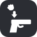

# CyberpunkVR Port

A full 6DoF **VR mod for Cyberpunk 2077**. Both eyes are rendered by the engine itself, the headset is tracked
through OpenXR, and the motion controllers drive a full-body avatar with physics hands: you aim the real gun, pull
the magazine out by hand, swing the blade, grab the steering wheel and pick things up.

**Requires:** Cyberpunk 2077 **2.5** (PC) and an OpenXR runtime (SteamVR, Virtual Desktop, Meta Quest Link, Pico
Connect, VDXR, ...). The package is self-contained: no other mods are needed.

Repository: <https://github.com/dariulone/cyberpunk-vr-port>

> ⚠️ Experimental community mod. Not affiliated with CD PROJEKT RED. Use at your own risk and keep backups of your
> saves.

**Contents:** [Installation](#installation) · [Controls](#controls) · [Features](#features) ·
[Settings](#settings) · [Logs and uninstall](#logs-and-uninstall) · [Test hardware](#test-hardware) ·
[Donations](#donations) · [Credits](#credits)

## Installation

1. **Launch the game once without the mod**, get to the main menu and quit.
2. **Extract the release archive into the game folder** — the one that contains `bin\` and `archive\`
   (for Steam: `steamapps\common\Cyberpunk 2077`).
3. **Start your OpenXR runtime, then launch the game.** In the small launcher window pick your headset and
   resolution and press *Start*.

## Controls

The controllers are merged into the game's own gamepad, so the game's *Settings → Key Bindings → Controller*
apply. The icons show the Meta Quest Touch controllers; other controllers use the buttons in the same places.
*To the stop* means the stick pushed all the way.

### General

| Input | Action |
|---|---|
|  +   0.5&nbsp;s | Open / close the **VR menu** |
|  | Pause menu (left controller on Touch, right on Steam Frame) |
|  +     to&nbsp;the&nbsp;stop | **D-pad** (quick slots, healing, phone, car, radio, dialogue lines) — see below |
|  | Pick the dialogue line (**A** in a vehicle) |

**D-pad chord.** Hold the **modifier** and push the **right stick to the stop** in the direction you want. The
modifier is the **left thumbrest** (thumb resting on it for 0.2&nbsp;s) on Touch controllers, and the **left stick
clicked in** on all others. While the chord is held the right stick does not turn the camera. Released without a
direction, the left stick click is an ordinary L3. On PSVR2, touching Triangle is the modifier; Steam Frame
has its own D-pad and bumpers.

The HUD shows every prompt with the controller's own buttons and chords. In **menus** and **braindances** the pad
is vanilla; the grips stand in for LB / RB in menus.

Keyboard:

| Key | Action |
|---|---|
|  | Recenter the headset |
|  | Game menus: full view or a small panel |
|  /  | The settings overlay (in the headset and on the monitor) |
| <kbd>Home</kbd> | The port's tool windows (VR weapon grip, camera, belt, magazine tuner) |

### On foot

| Input | Action |
|---|---|
|  | Move (fixed speed; *Analog movement* makes it follow the stick) |
|  to&nbsp;the&nbsp;stop, held 0.2&nbsp;s | **Sprint** |
|  | Turn (snap or smooth) |
|  to&nbsp;the&nbsp;stop | **Dash** in the direction of the left stick |
|  to&nbsp;the&nbsp;stop | **Crouch** (or just squat in the room) |
|  | Jump |
|  | Interact · reload |
|  /  | Fire / aim (the left trigger also blocks with a melee weapon) |
|  +  | **Draw / holster** a weapon at its place on the body |
|  tap | Next weapon |
|   | **VR weapon wheel**: point at a weapon, cyberware, a grenade or a consumable and let go |
|  weapon in hand | **Drop the magazine** (squeeze the free grip at the magazine to catch it) |
|  empty hands | Draw / put away the **arm cyberware** |
|  at the magazine | **Grab the magazine** — pull it out, carry it, push it home |
|  | **Slide release** (or rack the slide with the other hand) |
|  +   0.5&nbsp;s | **Combat gadget** (grenade, projectile launcher): aimed while held, used on release |
|  +   0.5&nbsp;s | **Cyberware ability** (Sandevistan, Berserk, overclock) |
|  +  | **Scanner** on / off — left controller at your left ear, click the left stick |
|  | **Melee**: swing a melee weapon — the hit lands along the blade |
|   + ,  | **Throw** a knife or a throwable weapon: hold the left trigger, take it in the right grip, throw and open the hand |
|  | Squat in the room: crouch |

**With the scanner open:** the left stick to the stop 
pages the quickhacks, **X**  applies one, the right trigger
 tags the target, the right stick click
 changes the tab, and the left trigger
+ right stick  +  zooms.

**Hands:** close a grip on a loose object to pick it up, on a person or a body to take hold of them, on a ledge to
climb. Loot, food and drink are ringed when a hand points at them; grip and flick back to pull them to the hand.
Food and drink go into the inventory at the hip, or are eaten / drunk at the mouth.

### Driving

| Input | Action |
|---|---|
|  +  /  | **Grab the wheel** / the handlebars |
|  | **Steer** — tilt the line through both controllers (one hand: around the wheel's centre) |
|  | Horn — a hand on the middle of the wheel |
|  /  | Throttle / brake |
|  with a weapon drawn | **Fire** — the left stick drives: forward is the throttle, back the brake |
|   1&nbsp;s | **Autodrive** |
|   | **Get out** (B never exits, so a stray press cannot throw you out at speed) |
|  | Pick the dialogue line |

Each hand is independent: hold the wheel with one and keep a gun in the other.

## Features

### 🖥️ Stereo and rendering

- **True stereo** — the second eye is a real engine view from its own position with its own projection, not a
  reprojected copy.
- **Each eye renders its own lens** — the exact off-centre field of view of your headset at full pixel density;
  fog, reflections, AO, shadows, particles, screens and holograms are corrected for each eye.
- **The eyes agree** — shadows, wind, reflections and exposure are shared, so nothing blinks or swims between them,
  and the exposure no longer swings when you turn your head.
- **Frame generation in VR** — NVIDIA optical flow + FidelityFX, FSR 3 interpolation or extrapolation, DLSS Frame
  Generation and ANR FG, with adaptive pacing and a performance overlay.
- **Upscalers per eye** — DLSS, DLAA, FSR 2 / 3 / 4 and XeSS, each eye with its own history; ray tracing works in
  both eyes. Experimental DLSS 5 Neural Rendering.
- **GPU savers** — fixed foveated DLSS, peripheral VRS, shared sun shadows
- **Everything in stereo** — braindances, surveillance cameras, turrets, the Basilisk, sniper nests, third-person and
  external vehicle cameras.

### 🧍 Body and hands

- **Full-body avatar** — your body under your head, arm-length calibration, leg IK and real squats; optional
  full-body tracking with three Vive Trackers ([setup](src/Fbt/Game/README.md)) and finger tracking.
- **Physics hands** — they stop at walls and tables, push loose things away and lay their fingers on what they touch.
- **Pick up anything loose** — with its real weight: one hand lifts a little, two hands a lot; throw it with a swing.
- **Take hold of people** — by an arm, a leg or the head; drag and carry bodies with two hands.
- **Climbing, swimming and ladders** by hand.
- **Roomscale** — walk, lean and squat in the room; optional physical body rotation and physical crouch.
- **Takedowns, carrying and finishers** keep the avatar in the game's animation, then hand it back.

### 🔫 Weapons and combat

- **Aim with the real gun** — bullets and projectiles leave the muzzle; shotgun spread stays spread.
- **Recoil in the hands**, not the camera — every weapon kicks by its own amount.
- **Two-handed grip** — the support hand steadies the aim and cuts the kick.
- **Physical reload** — pull the magazine, push a new one home, rack the slide. All weapons tuned one by one,
  the Overture revolver with its cylinder, ejected cases and speedloader. The gun glows amber where it wants your
  hand next.
- **Physical optics** — scopes are real lenses, sniper scopes see through their own camera, reflex sights stay on the
  bore.
- **Motion melee** — real swings deal the game's damage along the blade, against people and mechs alike.
- **VR cyberware** — mantis blades, gorilla arms, the monowire and the projectile launcher follow your arms.
- **Holsters on the body** — hip, shoulder harness and chest sheath; a tactical belt with magazines and grenades you
  pull the pin of.
- **Throws** — knives fly where you looked, with gentle aim assistance.
- **Dual wield, left-handed mode, controller vibration**, and a VR weapon wheel.

### 🚗 Driving and movement

- **A real steering wheel** — grab the wheel and turn it, horn on the hub, shoot from the car.
- **Motorcycles** — steer with the bars and lean.
- **Comfortable locomotion** — fixed-speed or analog movement, sprint, dash, snap or smooth turn, head- or
  hand-relative direction.

### 🎛️ HUD and interface

- **Native VR HUD** — every element placed, sized and shown where you want; world markers at their real depth in
  each eye.
- **The HUD speaks VR** — every prompt shows the controller's own buttons and chords.
- **VR menu** in the world — contacts, vehicles, radio, the pause menu's pages and every setting of the port.
- **Settings overlay in the headset**, live, without pausing the game.
- **UI fitted to the square view** — phone, radio, vehicle list, dialogue choices, tutorials and loot.
- **VR smoking** — a real cigarette and lighter, with the game's own smoke and sound.

### 🥽 Headsets

- **19 headsets, 188 resolutions** shaped to each headset's lenses, picked in the launcher: Quest 2 / 3 / 3S,
  Pico 4 / 4 Ultra, Valve Index, Steam Frame, PSVR2, Pimax Crystal and Dream Air, Bigscreen Beyond 2 / 2e,
  HP Reverb G2, MeganeX superlight 8K, Samsung Galaxy XR, HTC Vive / Vive Pro.
- **OpenXR and SteamVR** runtimes; native Steam Frame and PSVR2 Sense controller profiles.

## Settings

Every setting is in the **VR menu → Settings** and in the **F10 overlay** (point, click and drag with the
controllers): world scale and IPD, stereo, frame generation, HUD, controls, avatar and calibration, driving.
They are saved in `cyberpunkvrport\config\vrport.ini`.

The launcher, shown before the game starts, picks the headset and the resolution and has a **DEBUG** switch: leave
it off for play, it is for bug reports.

## Logs and uninstall

- `Cyberpunk 2077\cyberpunkvrport\log\cyberpunkvrport.log` — the port's log; attach it to a bug report. Tick
  **DEBUG** in the launcher for a detailed one.
- To uninstall, run `UNINSTALL.bat`, extracted into the game folder with the mod.

## Test hardware

- Headset: PICO 4 (via VDXR); also Meta Quest 3 (via Steam Link and VDXR)
- CPU: AMD Ryzen 7 5800X
- GPU: NVIDIA RTX 5070 Ti
- RAM: 32 GB DDR4
- OS: Windows 11 Pro 25H2 (26200)

## Donations

Donating is your personal choice. It speeds up development and makes new features possible — nobody is forcing you
to do it.

- <https://boosty.to/dariulone>
- <https://dalink.to/dariulone>

| | |
|---|---|
| USDT TRC20 | `TRgmDeRcFumXvsSRqYV5kQAqRAvoFKXJCt` |
| USDT BEP20 | `0x4638c6580d1e684bdc60a1c415e5cb1522b66942` |
| TRX | `TRgmDeRcFumXvsSRqYV5kQAqRAvoFKXJCt` |
| BTC | `13AfpBwZvaezf36FmpjtENHTXjYcnzEsze` |

## Credits

The port stands on the community's frameworks and tools. It no longer needs them installed, but it would not exist
without them:

- **[RED4ext](https://github.com/WopsS/RED4ext) / [RED4ext.SDK](https://github.com/WopsS/RED4ext.SDK)** — the
  engine's reverse-engineered types, RTTI and plugin model the port is built on.
- **[Cyber Engine Tweaks](https://github.com/maximegmd/CyberEngineTweaks)** — the scripting host the port's mods
  were first written for, and the TweakDB record names (`tweakdbstr.kark`, GPL-3.0) the port reads.
- **[redscript](https://github.com/jac3km4/redscript)** — the script compiler and language the port's game scripts
  were written in.
- **[ArchiveXL](https://github.com/psiberx/cp2077-archive-xl)** — the archive manifest format the port applies to its
  own archive.
- **[TweakXL](https://github.com/psiberx/cp2077-tweak-xl)** — the TweakDB record format of the port's records.
- **[WolvenKit](https://github.com/WolvenKit/WolvenKit)** — the modding toolkit every asset of the port was made with:
  archives, meshes, entities, animations and textures.

People:

- **[ClarkCheekyKent / CheekyFoveatedDLSS](https://github.com/ClarkCheekyKent/CheekyFoveatedDLSS)** —
  foveated DLSS research and the initial comparison backend.
- **[iPowerTech](https://github.com/iPowerTech/cyberpunk-vr-port)** — physical wheel steering, vehicle controls,
  shooting while driving, and the DLSS 5 Neural Rendering work.
- **[dabinn](https://github.com/dabinn/cyberpunk-vr-port)** — substantial work on weapon aiming, head aim and
  renderer stability; fixes adapted from his fork.
- **[Ajson44](https://github.com/Ajson44/cyberpunk-vr-port)** — extensive work on story progression, scripted
  cameras and quest interaction research.
- **[tig3rmast3r / OFXR Bridge](https://github.com/tig3rmast3r/OFXR-Bridge)** — open VR frame-generation research
  used as a reference for the native implementation.
- **[satyaloka93](https://github.com/satyaloka93)** — PlayStation VR2 support (controls, haptics, Sense input),
  frame generation and stereo DLSS work, the aiming dot in both eyes under engine stereo, configurable OpenXR /
  Toolkit haptics with per-hand feedback, and scope DLSS / Ray Reconstruction kept apart from the eyes' with
  full-resolution optics.
- **[Syncher-source](https://github.com/Syncher-source)** — finger tracking from OpenXR hand tracking, full-body
  tracking with Vive trackers, the HUD kept in front of the world and out of the hands' way, automatic recentering
  when the headset is put back on.
- **[EffinexX](https://github.com/EffinexX)** — the arm launcher's aim dot, lock-on markers for every smart weapon,
  the overlay's input capture with a resting grip, motorcycle steering with the bars and body lean, and the triggers
  and scanner reaching the game in camera takeovers and the sniper nest.
- **[Louspirit](https://github.com/Louspirit)** — B toggles the equipped arm cyberware from empty hands.
- **[ElvioRibeiro](https://github.com/ElvioRibeiro)** — the VRIK hands no longer freeze with low Windows memory
  allocations.
- **[Kenney](https://kenney.nl/assets/input-prompts)** — the controller and keyboard glyphs in *Controls* (Input
  Prompts, CC0); the VR gesture icons are drawn to match (`tools/controls_icons/make_icons.py`).
- **[Apex Neural Rendering](https://github.com/apex-compute/ANR)** — the ANR FG frame generation model, shipped
  unchanged beside the plugin.
