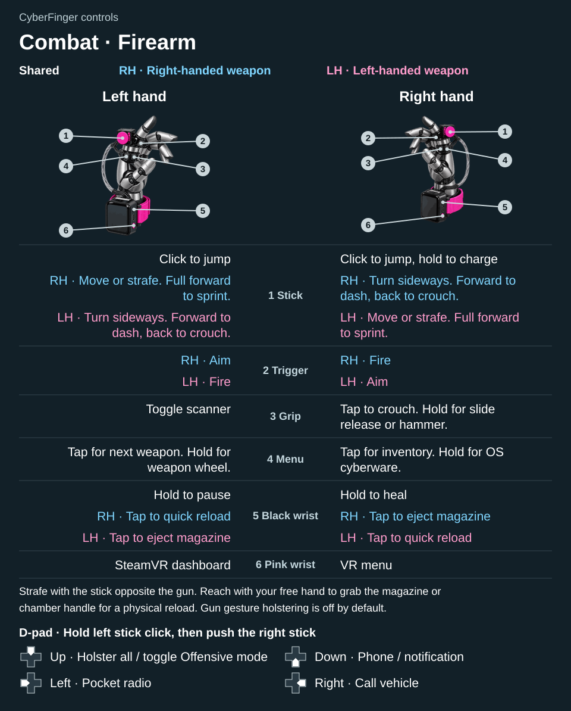
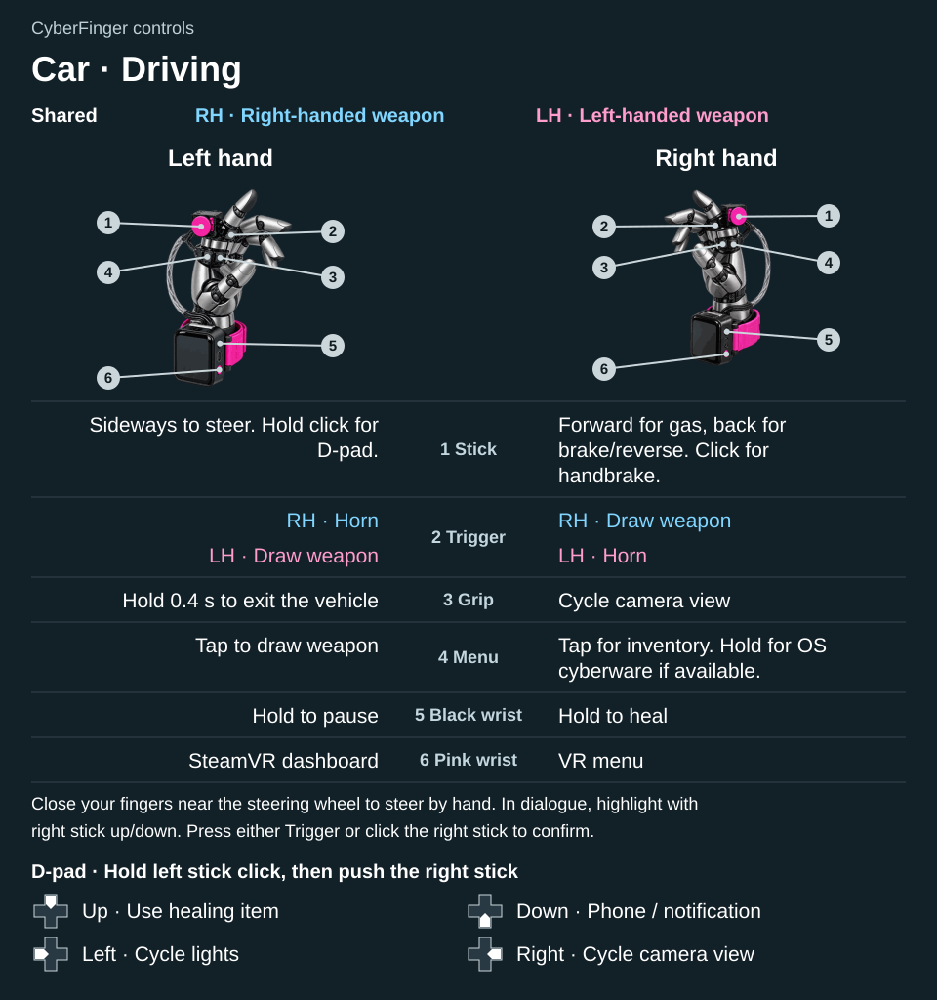
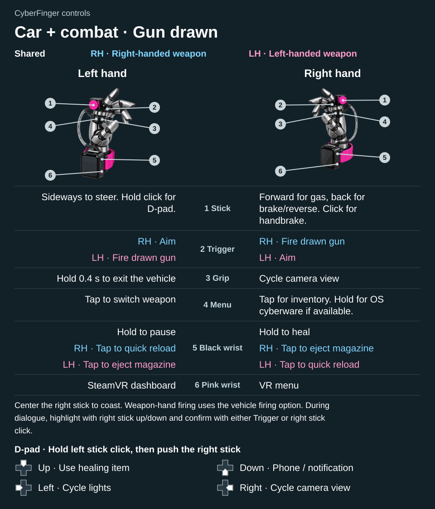

# CyberFinger + Cyberpunk VR: quick start

Quick start for **CyberFinger + SteamVR** with either weapon hand. Both layouts
use the **CyberFinger CyberpunkVRPort** SteamVR binding. Read the shared controls
first, then the right-handed assignments and the left-handed differences.
This checkout's installer defaults to a **left-handed weapon**. The setup used
here is a Quest Pro over Steam Link, an AMD RX 7900 XT and optional eight-tracker SlimeVR.

**Need settings right now? Press F10.** For snap turning:
**Controls > General > Turning (right stick) > Snap turn**, then **Save**.

[Next-session TODO and installation status](docs/cyberfinger-session-todo.md).

This source includes upstream through `1337b43d`, including the SteamVR/Radeon
projection change and per-eye FSR3 frame generation. The earlier 0.2.45
integration has a [merge report and headset checklist](docs/upstream-0.2.45-integration.md).

### CyberFinger controls

[See the illustrated controls for each context.](#buttons-at-a-glance)

These changes apply only when this profile is configured **and CyberFinger's
named actions are bound to an active controller**. Other controllers retain the
port's existing input behavior. This guide describes the intended controls of
this checkout; build, installation and live-test status are tracked separately
in the [session TODO](docs/cyberfinger-session-todo.md). Install matching DLL and
Lua scripts together. The v2 binding exposes right pink and both black-wrist
holds separately; the plugin assigns their roles below. No driver binary update
is needed for this revision.

| Menu control | Common behavior in this update |
|---|---|
| Hand ray + that hand's physical trigger | Point and click with either hand; no pinch needed |
| Touch a menu with a fingertip | Still available on the world-space VR menu; laser + trigger is an alternative |
| Physical grip button | **Secondary / context menu**, or **X** in original Cyberpunk menus; hold on F10's title handle to move it |
| Physical Menu button | **Back / Cancel / Close**, on release; **B** in native menus. Hold both for 0.5 s to toggle the HUD |
| Right pink wrist | Open/close the world-space VR menu |
| Left stick | Up/down/left/right focus navigation, like direction keys |
| Right stick left/right | Previous/next tab, without holding another button |
| Right stick up/down | Scroll where the menu supports it |
| Closed fingers | Nearby physical-object grabs only; never click, switch tabs, or move a menu |

F10 is the port's settings overlay. The larger world-space VR menu includes
gameplay pages (inventory, journal, etc.) and a **Settings** section which edits
the same settings as F10. The original Cyberpunk menus are a third presentation;
the refinement adds hand-ray navigation to those as well. Gesture shortcuts
such as the ear/scanner squeeze, menu swipe and fist/cyberware chord are removed
from the CyberFinger path. Physical hand/finger animation and direct fingertip
touches remain. A finger-close gesture does not click or move a menu.

No interaction should require holding the grab button while operating buttons
or the joystick on that same CyberFinger. Pointing and focus navigation must not
fight each other, and entering a menu with a held control must not click it.

**Pointing or highlight navigation:** move the left stick to navigate the
highlight; either trigger activates it. Deliberately move your pointing hand
to resume laser selection. The right stick changes tabs without a modifier.
In **Esc > Load Game** and other scrollable pause-menu lists, hold the physical **right stick up/down** to scroll. The left stick moves the highlight and either Trigger selects it. Both weapon-hand layouts use the same controls.
In the world-space VR menu and F10, right stick up/down scrolls the pointed list.
For the original game menus, keep Cyberpunk's PC window in the foreground for
laser clicks. F10's title strip is the move handle: point at it, hold that
hand's physical grip button, move your hand, and release. Grip elsewhere provides
right-click/context actions. There is no grip-plus-stick distance chord.

**Original Cyberpunk menus, including the wardrobe:** either hand's **trigger
is A / select**, **Menu is B / Back / exit**, and **Grip is X / the secondary
action shown on screen**. Hold Grip when the game asks you to hold X. Trigger
clicks your laser target; with stick focus or no ray target it activates the
highlighted item. A laser click never also emits a second A press. Tap and release
Menu for B; holding both Menu buttons toggles the HUD without also sending B.

Esc/pause, inventory, map/journal and PgUp's native character editor use a
visible hand laser like CET and F10. It ends at the same point that moves the
mouse cursor, including empty areas between controls. It starts from your
configured weapon hand. Pointing outside the canvas
keeps a short aiming beam; moving back onto it resumes the cursor. Joystick
highlight navigation or physical mouse control hides the beam until hand
pointer control resumes. Closing the menu or losing hand tracking hides it.

**World-space VR menu:** Menu dismisses a sort popup, returns from a section to
the main column, then closes. Point at an inventory/backpack item and press Grip
to show its existing item actions, or Grip the sorting control for sort options.
Grip does nothing on controls without secondary actions; it never substitutes
a primary purchase, equip, drop or confirmation. Fingertip selection still works.
The hand laser remains visible between buttons; button highlighting identifies
an actionable target.
Tap right pink wrist to open/close it when gameplay permits. If a weapon is
drawn, opening the menu holsters it first.

**Map:** your configured weapon hand points. Its Trigger selects and its Grip
right-clicks to track a waypoint. That hand's stick up/down zooms. The other
hand's Trigger performs **Tab / jump to V**, and its Grip opens the journal.
Menu on either hand closes/goes back. These hand roles swap with weapon handedness.
**Journal:** the other hand's Trigger performs **Tab / sort**; the pointing
hand's Trigger selects, Grip performs the secondary action, and Menu goes back.

**Apartment picture frame:** the photo selector fits on a stationary panel in
front of you, independent of head movement. Aim and press Trigger to select;
left stick provides directional navigation. Trigger confirms the focused photo,
Grip supplies its secondary/remove action, and Menu closes/cancels. Closing the
selector restores the normal HUD and gameplay controls.

**Computers:** use the hand opposite your movement stick as the mouse. Aim that
hand at the screen: the cursor follows the hand, not your head. **Trigger clicks**,
**Grip goes back within the computer**, its **joystick up/down scrolls**, and
**Menu exits the computer**. Direct fingertip touch remains available. With the
default left-stick movement this is your right hand; mirroring the movement
stick swaps the whole mouse-hand role. Grip does not require a stick/button chord.

**F10:** Menu cancels the active popup/edit first; on the idle panel it closes
settings. Grip with the laser right-clicks and opens panel options such as
**Recenter panel**. Grip on the title handle still moves the panel. Stick
navigation stays captured while menus are open, so it does not move or turn V.

**F10 pointing:** either hand can take over by pressing its Trigger. The laser
starts on the right for a right-handed weapon and on the left for a left-handed
weapon. CyberFinger ignores the older F10 pointer-hand override.

**Conversation choices.** Move the **right stick up/down** to highlight a reply,
then press **either Trigger** to confirm it. This works with either weapon hand.
While driving, **right stick click** also confirms. On foot, the **left stick**
still moves and **right stick left/right** still turns wherever the scene allows.
A Trigger already held when the choices appear needs a fresh press. After the
choices close, release each held Trigger and center the stick to resume their gameplay actions.
Ordinary nearby interaction prompts do not activate this dialogue layout.

**CyberFinger button hints.** When the game is showing controller hints, supported
HUD rows add the physical control in brackets after the action. In the driver's
seat, look for **[Tap Left Menu]** to draw and **[Hold Left Grip 0.4 s]** to exit.
On foot, quick reload shows **[Tap Left Black Wrist]** for a right-handed weapon
and **[Tap Right Black Wrist]** for a left-handed weapon. Nearby primary and
secondary choices name the Trigger or Grip on the hand opposite the movement
stick. A selected dialogue choice names **Either Trigger** and, for multiple
choices, **Right Stick Up/Down**.

Native menu hint rows also show CyberFinger controls. On the map, **Track waypoint** names your weapon-hand Grip and **Jump to V** names the other Trigger. In the journal, that other Trigger sorts. In the wardrobe, **Preview** uses Grip. In the apartment picture frame, **Confirm** uses Trigger and **Remove** uses Grip.

While driving, **Accelerate** and **Brake** name right-stick travel. **Handbrake** names **Right Stick Click**. Driver dialogue shows **Either Trigger or Right Stick Click**. With a gun drawn, aim and fire name their own triggers. The katana hint shows which hand can take the lower hilt, or **Swing either katana** when both are drawn. F10 and the world-space VR menu share the **Bindings** page, which also covers scabbard return, computers, the scanner and CET panels.

These labels use the active OpenXR bindings and the game's current action.
The first version recognizes English SteamVR and CyberFinger control names.
After using the desktop mouse or keyboard, move a CF stick to bring back the
controller prompts.
Keyboard prompts, unsupported actions, button combinations, and controls whose
physical assignment SteamVR cannot confirm keep their usual hints. The original
icons and hold indicators stay visible. A native menu laser can keep its CyberFinger
hints while moving the mouse cursor. Supported text-only VR tutorial cards use
the same labels. A mod that draws its own interface supplies its own widget text.

**HUD:** the main HUD and interaction panel are 25% larger by default. Hold
**both Menu buttons for about half a second** to hide/show them; release both before
repeating. Conversations, object interaction prompts (including the mirror),
and loot temporarily show the HUD, then restore your preference.
**F10 > HUD > Hide HUD (CyberFinger)** changes the same preference and shows
why it is temporarily revealed. Visible subtitles and cinematics also reveal
it; staged gameplay alone and cached inactive interaction choices do not.
The hide preference lasts for the current game session. **Enable HUD panel**
chooses VR-panel rendering; switching that off restores the native HUD rather
than hiding it. The hide/show shortcut affects the main HUD and interaction
panel, not separate scanner, vehicle-camera or hit-marker layers.
Left-stick + right-Grip is retired; those controls keep their ordinary actions.
For another size, set `hud_scale=1.25`
(range `1.0` to `2.0`) in the plugin's `config/cyberfinger.ini`, then restart.

The captured **CyberFinger HUD preset** uses **56.2° FOV**, **1.17 m stereo
depth**, head follow with a **60° free-look cone**, and wall avoidance on.
**Hands push the HUD out of view is off.** All individual HUD elements are
enabled with their original position, size and opacity. Wall-avoidance growth is **0.51**.
Interactions/dialogs stay at **0.84 m**, **57.5° FOV**, with head-locked follow;
brightness, shadow and glow are **1×**. The CyberFinger 1.25× HUD scale still applies.
The full preset is [cyberfinger-hud.ini.example](mods/config/cyberfinger-hud.ini.example).
Fresh/missing HUD settings use this preset during CyberFinger installation;
updates preserve your existing tuning. To deliberately restore this entire
preset, pass `-ResetHudDefaults` to the installer. F10's **Reset element** and
**Reset all elements** remain the game's neutral element layout controls.

[Start playing](#start-playing) · [Buttons](#buttons-at-a-glance) ·
[Grabbing and weapons](#grabbing-and-weapons) · [VR settings](#vr-settings) ·
[SlimeVR](#optional-eight-tracker-slimevr) · [Troubleshooting](#troubleshooting) ·
[Streaming](#streaming-one-eye-at-1920-x-1080) · [Install/update](#install-or-update)

## Start playing

1. Connect Quest Pro through **Steam Link** and start **SteamVR**. Enable Quest
   hand tracking. For eye-tracked foveation, also enable/calibrate eye tracking
   and allow Steam Link to share it with PC apps.
2. Start **CyberFinger Bridge** and connect both CyberFingers. Confirm both hands
   move in SteamVR. In the bridge, set **Right pink button = SteamVR** so that
   button reaches the game instead of controlling microphone mute/FluxAction.
3. Launch **Cyberpunk from Steam or GOG**.
   For a monitor-only session, choose **Play on desktop**. You can skip headset and SteamVR setup
   for that launch. To bring back a hidden startup dialog, set `show_launcher=1` in
   `red4ext/plugins/cyberpunkvrport/config/vrport-launcher.ini`. For VR, choose
   **Meta Quest Pro**, **SteamVR**, and **2080 x 2104 (Balanced)** as the initial
   resolution, then click **Play in VR**. Leave **DEBUG off** for normal play; enable it when collecting
   diagnostic logs.
4. For the first launch or after a binding reset, keep the game running and open
   SteamVR's **Settings > Controllers > Manage Controller Bindings**. Choose
   **CyberpunkVRPort**, the **CyberFinger** controller, and the custom
   **CyberFinger CyberpunkVRPort** layout. OpenXR actions become available when
   the game initializes VR. A saved custom layout takes priority over driver
   defaults; normal launches reuse your selection.
5. If first-run setup asks, point and press Trigger to choose your weapon hand.
   Choose **Right hand** for a right-handed weapon. For a left-handed weapon,
   choose **Left hand**, then **Same as right-handed** to match the diagrams.
   Load a save or start a game. Full-body calibration needs a loaded game.
6. Face your intended forward direction and press **F7** to recenter. Open and
   close your hands: V's fingers should follow before you rely on finger grabs.

SteamVR must be running for this VR setup. Omitting it is not the mod's flat-mode
switch. A side-by-side desktop mirror is normal; the headset should show an
immersive scene during gameplay.

**Loading a save in VR.** The November 18 integration build gives both eyes one
OpenXR panel about **3 m ahead**. You can turn your head and look away from it.
The artwork can pause near the end of a load while the desktop switches back
to stereo. Loading a save has been confirmed in the Quest Pro. On **Esc → Exit
to Main Menu**, the port holds the artwork on the same panel until the lobby
is ready. The return trip still needs an in-headset retest with the correction.
[Loading investigation](docs/loading-transition-investigation.md)

## Buttons at a glance

Find the numbered control on the **physical left or right CyberFinger**. In each image, **white** text applies to both weapon hands. **Blue (RH)** shows the right-handed assignment, followed by **pink (LH)** for the left-handed difference. Both layouts use the same SteamVR binding. The diagrams assume full-forward sprint and **Same as right-handed** bindings when using a left-handed weapon.

[Shared controls](#shared-controls) · [Weapon-hand differences](#weapon-hand-differences) · [Diagrams by context](#diagrams-by-context)

#### Shared controls

| Context | Both weapon hands |
|---|---|
| Walking | With the gun holstered, left stick moves and right stick turns. Partial travel walks. Hold the movement stick fully forward for about 0.2 s to sprint. |
| Turning and jumping | On the turn stick, push sideways to turn, forward to dash/dodge, or back to crouch. Dash and crouch trigger past 80% travel. Center the stick before repeating. Left stick click jumps on release. Right stick click jumps on press and can charge a jump while held. |
| Taking, using and scanning | At a prompt, right Trigger takes/interacts and right Grip eats/uses. In exploration, left Grip toggles the scanner. In the scanner, push the left stick fully up/down to page quickhacks and press right Trigger to confirm. |
| Firearms and melee | With empty hands and Offensive mode on, press and release the weapon-hand Trigger alone to draw. With a gun drawn, tap right Grip to crouch or hold it for 0.65 s to close a locked slide or operate a supported revolver hammer. With a katana, one-handed swings are fast and two-handed swings are strong. For fists and other melee, either Trigger modifies swing strength. |
| Driving and driver combat | Steer with the left stick or grab the wheel. Right stick forward gives analog gas, back brakes/reverses, and center coasts. Click it for the handbrake. Tap right Grip to cycle view, hold left Grip for 0.4 s to exit, and tap right pink for the VR menu. |
| Conversation choices | Right stick up/down highlights. Either Trigger confirms. While driving, right stick click also confirms. |
| Native menus | Left stick navigates highlights. Right stick sideways changes tabs, including on the map. Trigger selects, Grip performs the secondary action and either Menu goes back. Map and journal shortcuts are listed below. |
| Computers | Aim with the right hand. Right Trigger clicks, right Grip goes back and right stick up/down scrolls. Either Menu exits. |
| Menu and wrist shortcuts | Hold left black to pause or right black to heal, on foot or driving. Left Menu tap/hold cycles weapons or opens the wheel. Right Menu tap/hold opens inventory or activates OS cyberware. Hold both for 0.5 s to toggle the HUD. Left pink opens SteamVR. Right pink opens the VR menu. |
| Physical grabs | Close your fingers near a grabbable object, then open your hand to release it. **Grip** in the diagrams means the physical button. **Menu** is the ring button Resonite uses for its dial. |

<a id="left-handed-and-right-handed-weapons"></a>

#### Weapon-hand differences

| Control or context | Right-handed weapon (RH) | Left-handed weapon (LH) |
|---|---|---|
| Gun drawn on foot | Left stick moves/strafes, right turns. Right Trigger fires, left aims. | Right stick moves/strafes, left turns. Left Trigger fires, right aims. Center the sticks after drawing or holstering to engage their new roles. |
| Physical reload | Left hand grabs the magazine or chamber handle. | Right hand grabs it. |
| Black wrist taps with a gun drawn, on foot or driving | Right ejects. Left quick-reloads. | Left ejects. Right quick-reloads. |
| Driver triggers | Right draws or fires. Left sounds the horn while unarmed and aims with a gun drawn. | Left draws or fires. Right sounds the horn while unarmed and aims with a gun drawn. |
| Fists and melee | Left Grip switches between fists and equipped melee. This takes priority over the scanner while the melee toggle is available. | Right Grip switches between fists and equipped melee. Left Grip operates the scanner. |
| Native menu, picture frame and F10 lasers | The laser starts on the right. | The laser starts on the left. |
| Map and journal | Right hand points and selects. Right stick up/down zooms the map. Right Grip tracks a waypoint. Left Trigger jumps to V or sorts the journal. Left Grip opens the journal from the map. | Left hand points and selects. Left stick up/down zooms the map. Left Grip tracks a waypoint. Right Trigger jumps to V or sorts the journal. Right Grip opens the journal from the map. |
| CET windows | Right hand starts with the laser and scrolls. Left stick changes tabs. | Left hand starts with the laser and scrolls. Right stick changes tabs. |

When you transfer the CET laser, scrolling follows the new laser hand and tab switching follows the opposite hand. For a different left-handed layout, **Left stick walks, buttons mirrored** swaps the native face buttons. **Left stick turns, buttons mirrored** also swaps the native sticks and their clicks, so the right stick normally walks and the left hand operates computers and nearby prompts.

#### Diagrams by context

[Normal](#normal-on-foot) · [Gun combat](#gun-combat) · [Melee](docs/controls/cyberfinger-melee.svg) · [Car](#car) · [Car + combat](#driver-combat)

#### Normal on foot


#### Gun combat



[Fists and melee diagram](docs/controls/cyberfinger-melee.svg) · [Katana diagram](docs/controls/cyberfinger-katana.svg) · [Scanner and quickhacks diagram](docs/controls/cyberfinger-scanner.svg)

#### Car

In both driver-seat contexts, use the right stick like a two-way pedal. Move it partway for partial gas or braking. Release it to coast.



#### Driver combat



#### Gamepad D-pad shortcuts

Center the right stick, **hold the physical left stick clicked in**, and push the right stick toward one of the four directions. Hold that direction for a hold action. Release the left click and center the right stick before resuming throttle or brake. The diagrams above show the corresponding gamepad cross with the active direction highlighted.

| D-pad | On foot or in combat | Driving or driver combat |
|---|---|---|
| ↑ Up | With empty hands, toggle **Offensive mode**. With a weapon, fists or grenade drawn, put everything away and switch the mode off. | Use the equipped healing item where available |
| ↓ Down | Open the current notification or message. Hold for the phone when available. | Phone or current notification when available |
| ← Left | Pocket radio. Hold for radio selection. | Cycle vehicle lights. Supported vehicles also offer a siren or customization on this direction. |
| → Right | Call the vehicle. Hold for vehicle selection. | Cycle camera view. Tapping right Grip sends the same direction. |

**Offensive mode** starts on for a new installation. On foot, center the right stick, hold the left stick click and push the right stick up once. If you're armed, this puts away both hands, including a held grenade. Once the HUD shows **Offensive mode OFF**, look down in FBT or look at V in a mirror to see V’s outfit, including any belt that belongs to the clothing. The tactical belt itself disappears along with its pouches, ammunition, grenade, holsters and scabbards. With gear hidden, Trigger still interacts and confirms. Empty-hand Trigger draw and belt pickups are disabled.

Repeat the shortcut with empty hands to restore your gear permanently. If you leave the mode off and draw a gun, melee weapon, fists or grenade through the wheel or a game action, your gear appears temporarily. Putting the last item away restores your saved preference. If you left the mode on, holstering normally keeps the belt visible. Hold the **right black wrist button** to heal on foot.

**Left-handed CyberFinger grenade pickup.** On the port's tactical belt, the grenade sits at the front right. Reach across with your left hand and close it at the holder. Either hand can pick it up, and the prop follows the hand that took it.

The game chooses the action for the active screen, equipment and vehicle. Native menus use left-stick focus and right-stick tabs directly. Dialogue uses right-stick up/down directly. Neither requires holding left click.

#### Menu and interaction diagrams

| Context | Open the diagram |
|---|---|
| Conversations and devices | [Dialogue choices](docs/controls/cyberfinger-dialogue.svg) · [Computer](docs/controls/cyberfinger-computer.svg) · [Apartment picture frame](docs/controls/cyberfinger-picture-frame.svg) |
| Original game menus | [Esc, inventory and wardrobe](docs/controls/cyberfinger-game-menus.svg) · [Map](docs/controls/cyberfinger-map.svg) · [Journal](docs/controls/cyberfinger-journal.svg) |
| VR and mod panels | [VR menu](docs/controls/cyberfinger-vr-menu.svg) · [F10 settings](docs/controls/cyberfinger-f10.svg) · [CET windows](docs/controls/cyberfinger-cet.svg) |

To switch among all the diagrams offline, open the [controller guide](docs/controls/cyberfinger-controls.html) in a browser.

About three-quarters forward gives you ordinary movement, just as on Quest.
For finer walking speeds, enable **Analog movement** under **F10 > Controls**.
Ease back from full forward to stop requesting sprint. The left click jumps on
release so you can use a D-pad shortcut without jumping. For a jump on press
or a charged jump, use the right stick click.
To use the older click-to-sprint layout, choose **F10 > Controls > Sprint >
Click the left stick**. The right stick still handles jump in that layout.

**Taking and using objects:** on the hand opposite the movement stick, Trigger
performs the primary **Take / Interact (X)** prompt and Grip performs the secondary
**Eat / Use (Y)** prompt. Hold the control when the prompt calls for a hold.
This includes doors, mirrors and wardrobes; it follows the game's available
interaction and does not bypass locks or quest conditions. Prompt actions take
priority over that hand's aim/fire/scanner/melee utilities; release before those
utilities resume. Outside an interaction prompt, normal weapon controls return.
In standard menus, either laser hand's Trigger selects except for the explicit
map/journal off-hand Tab shortcut above.

Black wrist **short presses register on release**. With a gun drawn, tap the weapon-side wrist to eject where supported, or tap the other wrist to quick-reload. An empty hand has no magazine to eject. With either weapon hand, **hold left black to pause and right black to heal**. A hold consumes the tap. Pink buttons stay fixed. Use the default v2 binding;
the older optional *pink pause* variant is not this layout.

| Shortcut | Action |
|---|---|
| F10 or Insert | Open/close the VR settings overlay |
| Escape while the settings overlay is open | Close the overlay |
| Right pink wrist | Open/close the VR menu; use its Settings pages |
| Both physical Menu buttons, held about 0.5 s | Hide/show HUD; prompts and conversations temporarily reveal it |
| F7 | Recenter headset |
| F8 | Toggle the game's menu display between a large view and a smaller panel |
| Hold left stick click, push right stick fully in a direction | D-pad navigation; suppresses turning while held |
| Hold right Menu about 0.65 s | Activate equipped operating-system cyberware in gameplay; release does not open inventory |

The controller shortcuts need the correct binding; **F10 works independently of
those button assignments**. Focus the game window if keyboard shortcuts do not
reach it. Point and trigger-select in the overlay, or use the desktop mouse.

### CET and Character Preset Manager

The local GOG installation is configured with **Page Down for CET's Overlay
Key** and **Page Up for Character Preset Manager's character editor action**
(`preset_manager_open_editor_input`). These are separate keys, not a chord.
For another installation, assign and save them in CET's Bindings page; the VR
mod installer does not enforce them. Restart after changing bindings: the VR
port reads CET's overlay key at startup.
Avoid F8 + F9: F8 changes the VR menu display and F9 is the game's quick-load key.

CET's own overlay and Character Preset Manager's CET window require the new
**CET renderer adapter** for stereo/laser integration. Updating only the VR
plugin does not change stock CET's SBS rendering. The mod-panel integration is
a development build. The `mod-ui-r3` / CET adapter `r2` correction fixes the
earlier build's stuck CET input capture, native-menu anchoring and mouse handoff.
See the [session status](docs/cyberfinger-session-todo.md) for installation and
headset validation status.
Character Preset Manager also opens a native character editor; New Game Plus
Native adds native game menus. Those screens use the native game-menu path.
The overlay-toggle freeze is still under investigation; changing the shortcut
removes an input conflict but is not a confirmed crash fix. See the
[CET investigation](docs/cet-vr-compatibility-20261114.md).

### Mod windows in VR (development build)

There are two common rendering paths: Cyberpunk's **ink** UI and **CET ImGui**.
RED4ext, redscript, Codeware, ArchiveXL and TweakXL are not separate window
renderers. Native modal mod menus share the game's menu controls. With
CyberFinger active, their canvas stays where it opened instead of following
your head. Computers and other world devices retain their surface interaction.

Adapted CET windows and the port's Lua windows use a separate **1440 x 1080**
canvas displayed to both eyes. They open in front of you and stay in place.
Your configured weapon hand is the preferred laser hand. Point with the other
hand and press its Trigger to transfer the pointer after releasing the first.
Brief tracking loss does not silently swap the CyberFinger pointer hand;
reopening a mod panel restores your configured preference.

**Page Down opens and closes the entire CET panel.** Closing it removes the
windows, top strip and laser, and returns movement and interactions to the game.
If a controller button or stick was held while closing, release it once first.
CET mods that draw continuously in `onDraw` do not leave an active panel behind;
their CET canvas is shown only while CET is open in VR.

**Panels too large or following your head:** in this development build,
CyberFinger native menus, F10 and adapted mod windows use the same physical
panel bounds. Wide SBS canvases fit inside those bounds without stretching or
making the panel wider. The defaults match the saved Quest Pro setup:
**123% panel scale**, **1.22 m away**, centered horizontally and vertically.
That gives bounds of about **1.91 m wide by 1.43 m high**; wide menus use less height.
Fresh configurations and **Reset** use these defaults; saved custom settings
continue to take precedence.
Use **F10 > Overlay > Panel size** to shrink or enlarge them, then **Save**.
**Distance** changes where native/mod panels open next; close and reopen those
panels after changing it.

Panels keep their world position and orientation while you turn or lean, switch
menu tabs, temporarily open F10, or briefly lose tracking. Grip still moves F10
and mod panels by their top strip. Closing and reopening a panel, or recentering
tracking, anchors it again. The gameplay HUD and in-world computer screens keep
their own placement rules. Other controllers retain their existing native-menu
and F10 follow settings.

| Input | Mod panel action |
|---|---|
| Laser-hand Trigger | Click/select; hold to drag a slider |
| Laser-hand Grip | Right click/context action |
| Grip on the top strip | Move the whole panel |
| Laser-hand stick up/down | Scroll |
| Opposite-hand stick left/right | Switch standard ImGui tabs |
| Either Menu, released | Cancel a popup/edit, then close the host overlay |

The laser stays visible over empty space. Finger-close and pinch gestures do
not click these panels. Game movement and firing are suppressed while an
interactive panel has focus; release held buttons before resuming gameplay.
F10 and the world VR menu take priority over mod panels.

**Mouse:** moving or clicking the physical mouse takes over native menus
(including Esc and the character editor) and adapted mod windows. Press Trigger
to return to laser control; native-menu joystick navigation also takes over.
The CET mouse cursor is visible on its VR canvas. F10 retains its desktop
click/wheel takeover; CET yields its Win32 mouse/keyboard handler while F10 has
focus, and lets F10/Insert through even when CET is open.

CET's toolbar buttons and custom hand-drawn tabs remain laser-clickable.
Closing a mod window that stays open independently of CET may require its own
close button. Decorative ink HUDs are not automatically converted into modal
panels. Keyboard text entry still uses the keyboard. See
[renderer coverage, adapter setup and validation](docs/mod-ui-vr.md).

## Grabbing and weapons

- **Nearby grab:** open your hand, bring it close to a grabbable object, then
  close at least three fingers. World-item grabs use a roughly **32 cm palm
  radius**. An open hand does not automatically pick things up; distant pull is
  disabled. Holsters and weapon parts have their own grab distances.
- **Release:** open your hand. After a tracking interruption, open it once before
  attempting another grab. A physical grip-button press does not replace missing
  finger tracking in this profile.
- **While using buttons/sticks:** a new finger grab is blocked while that hand's
  controls are active. Release the controls and open your hand before closing it
  to grab. An object already held stays held while you operate its trigger.
  Menu entry also blocks new grabs. Pinch is not a menu-click gesture; this
  build's nearby grab recognizer still uses closing at least three fingers.
- **Weapon wheel:** hold **left Menu**, point at the desired entry, then release
  Menu. The mod's VR wheel is controlled by **Controls > VR weapon wheel on a held Y**.
- **Holsters/support:** reach to a holster and close the drawing hand. To support
  a gun, bring the free hand to its support point and close it; open to release.
  **Gesture holstering defaults to Off for guns and On for swords and other melee weapons.**
  Open **F10** or **VR menu > Settings**, then **Controls > General**. Set
  **CyberFinger gun gesture holstering** and **CyberFinger melee gesture holstering** independently.
  On upgrade, your previous gesture holstering choice carries over to guns.
  Under **CyberFinger holster types**, turn each body holster on or off. With an enabled immersive holster you can reach to draw even when gesture holstering is off. Switching a type off removes its worn weapon and holder and disables drawing or returning it there. The wheel and inventory still work.

  | Holster switch | Includes | Default |
  | --- | --- | --- |
  | Handguns | Pistols and revolvers | Off |
  | Machine guns | Submachine, light and heavy machine guns | Off |
  | Shotguns | All shotguns | Off |
  | Knives | Knives and short blades | On |
  | Grenades | Tactical belt grenade and its pickup, in either holster mode | On |
  | Swords | Katanas, swords, long blades, machetes and chainswords | On |
  | Rifles | Assault, precision and sniper rifles | Off |
  | Other melee | Axes, clubs and hammers | On |

  Your choices persist across restarts. With Offensive mode off and both hands empty, all worn gear is hidden. Switching the mode shows **Offensive mode ON** or **Offensive mode OFF** at the center of your headset view for two seconds, even with the HUD hidden or moved.
  To put an enabled weapon away in simple holster mode, close the weapon hand within
  **12 cm** of a hip or shoulder. Immersive hip katanas use the scabbard return below.
- **Katana hand and scabbard.** With **F10 > Controls > General > CyberFinger swords in right hand** on (default), automatic immersive holsters place the katana at the left hip and V draws it with the right hand. This also applies with left-handed guns. Turn the option off to follow the weapon-hand setting for swords. Hip-mounted katanas share a dark scabbard with brass trim that stays on the belt while the sword is drawn. The inventory’s **Hide holsters** control hides it.
- **Draw.** In **Holstered** or **Fists**, line up the centre of V’s drawing hand with the wrapped handle, about a palm-width below the guard. Tap **Grip** there, or close your fingers around the handle and pull clear. You can steady the first scabbard with your free hand. Some scripted scenes require empty hands. If the blade appears briefly there, try the same wheel draw outside after the scene ends.
- **Draw with the Grip button.** With Offensive mode on and the sword visible on your belt, tap the drawing hand’s **Grip** at its hilt. This works from **Holstered** and **Fists**. With the default sword setting, use right Grip at the left hip. If you equip swords in the left hand, use left Grip at the right hip.
- **One sword, two grips.** Swing with one hand for a **fast** attack. Tap the free hand’s **Grip** at the lower hilt to latch a two-handed hold for **strong** swings. Tap the same Grip again to release. You can also close and open the free hand on the hilt for momentary support. Away from the sword and scabbard, the free hand can punch.
- **Put away with Grip.** Tap the Grip on the hand holding the katana. This holsters it directly. With two blades, the secondary hand puts away its own blade. Putting away the primary ends dual wielding. The physical button works with gesture holstering switched off.
- **Equip two katanas in the VR menu.** Tap the **right pink wrist button**, open **Inventory**, and use the laser and Trigger to select a numbered weapon slot. Choose **Melee**, select a katana you own, and press **Equip**. Select **Equipment** to return to the slot overview. Repeat with a different katana in another numbered slot.
- **Check both holsters.** On that overview, look immediately to the right of each katana’s tile for the small body icon. A cyan **A** on the icon means **Auto** is already selected. To change it, select the icon and choose **Auto**, the leftmost option. Set the bottom toggle to **Holsters: Shown**. If the icons are missing, open **F10 > Controls > General** and enable both **Immersive holsters** and **Swords**.
- **Which katana goes where.** The two **Auto** katanas follow their numbered weapon slots. With the default sword setting, the lower-numbered katana sits on your **left hip** for your **right hand**. The next sits on your **right hip** for your **left hand**. Draw the first, then take the second at the same spot on its handle with your left hand. Selecting a weapon from the wheel keeps the same hip assignments. Explicitly choosing left-hand swords mirrors the pair.
- **Return the second katana.** With melee gesture holstering enabled, bring your **right hand** to the top of the **right-hip scabbard** as if bracing it. You can keep the first katana in that hand. Bring your closed **left hand** to the opening and open it while your right hand is still there. The second katana goes back and your left hand is free. With left-hand swords, swap sides.
- **Put away.** In the default layout, take your left hand off the hilt. With the sword clear of your hip, close your left hand on the scabbard first. Bring your closed right hand to the opening, then **open just your right hand**. V puts the katana away and plays the return sound. You can keep your left hand closed. If you carry the sword in your left hand, swap hands. Moving away before release cancels the return.
- **Tutorial cards:** Text tutorials such as Songbird’s Relic perk-tree introduction open on a floating panel in front of you. Turn your head to read across the panel. The game’s usual Continue action dismisses it. Tutorials with pictures or video use the game’s presentation.
- **Hide holstered weapons on V.** Tap the right pink wrist button, open the VR
  menu's **Inventory**, then select **HOLSTERS: SHOWN** to switch to **HOLSTERS:
  HIDDEN**. You can still draw from the same places. To remove just the sword
  from your body, select the holster badge beside its weapon slot and choose
  **NOT CARRIED**. Turning off **Immersive holsters** under **F10 > Controls**
  also hides the weapons and switches drawing to fixed weapon-slot zones.
- **Remove the grenade belt.** With a save loaded, press **Scroll Lock** (the
  VR port's Lua overlay key on this setup). In **VR tactical belt**, uncheck
  **keep it equipped**, then scroll down and select **take off** beside
  **equip now**. Press **Scroll Lock** again to close the overlay and save.
- **Physical reload:** reach with the hand opposite the weapon. Open your fingers,
  then close them at the highlighted part. Reload with your **left hand** for a
  right-handed gun or your **right hand** for a left-handed gun.
  - **Magazines:** tap the weapon-hand black wrist to eject where supported.
    If the game lets you pull a seated magazine by hand, an empty one also accepts a
    fresh grasp at its marker. For an early swap on a magazine that doubles as
    a support grip, hold the free-hand Trigger as you grasp it.
  - **Handles:** if a handle lights up after you insert the magazine, open your
    free hand at the marker and grasp it for the indicated motion. This also
    works on the Grad when its handle lights up after a shot. The original
    free-hand Trigger input remains available on trigger-operated handles.
    On handles and slides with a recorded grasp, you can also touch the
    moving part with the **pinky side** of your open hand and close your
    fingers. Keep your wrist at that angle through the pull. On the
    **Nekomata**, either side of the chamber handle accepts this grasp.
  - **Nekomata magazine:** with the tactical belt enabled, reach to the rifle
    magazine on your free-hand hip. The belt uses the Copperhead magazine as
    its marker. Picking it up puts the Nekomata magazine in your free hand.
  - **Carnage and Tactician:** when the pump needs cycling, open and close your
    free hand at its marker, or close the pinky side against the pump, then
    move it back and forward. Keeping your fingers
    closed after that stroke returns the hand to supporting the weapon.
  - **Single-round sniper reload:** on the Ashura, grab and insert the round
    with your free hand as before.
  - **Quick reload:** tap the free hand’s black wrist (left for a right-handed
    gun, right for a left-handed gun), or
    press **R**. Hold **right black** to heal. **Right Grip** crouches on a tap. Hold it for **0.65 s** for the button shortcut, which closes a locked slide or toggles the hammer on a supported revolver. Grasping and moving the highlighted chamber handle with the free hand is a separate tracked action.
- **Scanner:** tap left physical grip to open; tap again to close. Full up/down pushes on the left stick
  page the quickhack list; the **Trigger opposite the movement stick** applies
  the selected hack (right Trigger in the default layout). Release it before
  normal weapon aim/fire resumes.
- **Auto fist fight mode.** With Offensive mode on and your hands empty, raise both hands in front of you. Either **tap both Triggers together** or **make two tracked punches with closed hands**, one with each hand within one second, in either order. Both shortcuts draw bare fists. Switch them off together under **F10 > Controls > General > Auto fist fight mode (CyberFinger)**. To draw your usual weapon instead, press and release only the weapon-hand Trigger. Overlapping Trigger presses cancel that weapon draw, in either release order.
- **Block with bare fists.** Hold both physical Triggers with both hands raised in front of you. Release either Trigger or lower either hand to drop the block. This works with **Auto fist fight mode** switched off if you equip fists from the wheel.
- **Fists / melee weapon:** with fists or an ordinary melee weapon in hand,
  tap the **Grip opposite your configured weapon hand** (left for a right-handed
  weapon, right for a left-handed weapon)
  to switch between **bare fists and an equipped melee weapon**. It remembers
  your last melee weapon while it remains in a weapon slot, otherwise uses the
  first equipped melee weapon. With no melee weapon equipped, it leaves fists
  selected. **Left Menu** keeps general weapon cycling, including guns.
  Menus, interactions, scanner use and nearby held objects take priority over
  this shortcut; release Grip before pressing it again after a context change.
  This toggle is installed for testing; in-headset combat validation is still pending.
- **Melee attacks:** physically jab/punch or swing your equipped melee weapon.
  **No Trigger is needed for a normal attack.** With CyberFinger active, hold
  **either physical Trigger before starting the swing** to make it a strong
  attack with fists, arm cyberware and other melee weapons. For a katana, grip with one hand for fast swings or two hands for strong swings. Trigger presses alone do not launch
  attacks; tracked motion and contact are still required. Other controllers
  keep their existing attacking-hand Trigger modifier. Combat still needs
  in-headset playtesting. Physical grabs and throws depend on valid finger
  tracking; weapon-specific mechanics are detailed in the
  [main controls reference](README.md#controls).
- **Driving:** close a hand near the wheel/handlebar to grab it, then steer with
  your hands. To **exit**, hold the **physical left Grip button** for **0.4 seconds**
  while seated. Use the same left button with either weapon hand. The keyboard
  shortcut is **F**. Holding the left black wrist button pauses.
  Right stick click applies the handbrake. During driver dialogue, use right stick up/down to highlight a choice, then press either Trigger or click the right stick to confirm.
  **Right stick forward accelerates and backward brakes or reverses**. During dialogue the stick selects choices. Center it after dialogue to resume driving. Tap **right Grip** to cycle camera view. Use the weapon-hand Trigger to draw or fire (with vehicle firing enabled). The off-hand Trigger sounds the horn before drawing and aims afterward.

To quit normally, close the VR overlay and open the game's pause menu. Hold the
left black wrist button, or press Escape, then use the game's
exit option. **F10 / Insert stays keyboard-only**; right pink opens the
world VR menu instead.

**Crash report after Alt-F4:** the included shutdown fix releases cached HUD
widgets before the game engine shuts down. Previously, their late destruction
could crash after VR had already closed. Save your progress before testing
Alt-F4 after loading a save; confirmation in the running game is still pending.

## VR settings

Open **F10** and click **Save** after changing settings. In **Controls**, select
the **General** subpage rather than Driving or Bindings for the settings below.

| Setting | Where / what to choose |
|---|---|
| Snap turn | **Controls > Turning (right stick)**: enable **Snap turn**, choose **Snap angle** (30 degrees is the preset) |
| Right-handed weapon | Turn **Left-handed controls Off**. Right Trigger fires and left stick moves. |
| Left-handed weapon | Turn **Left-handed controls On** and choose **Same as right-handed**. Left Trigger fires and right stick moves with a gun drawn. See the [weapon-hand differences](#weapon-hand-differences). |
| Visible finger animation | **Controls > Finger Tracking > Enable finger tracking**; restart the game after enabling |
| Physical crouch | **Controls > Physical crouch** and its depth control |
| Movement direction | **Controls**: choose Game, HMD, left-hand or right-hand locomotion |
| Eye-tracked foveation | **General > Variable Rate Shading > Eye-tracked foveated rendering** |
| Full-body tracking | **Controls > Full-Body Tracking**; calibration described below |

**Stuck low with bent knees and slow movement:** close F10 and CET, then tap
**C** (the game's default keyboard crouch toggle). This restored normal standing
in the recorded session; physical crouch was not requesting the low stance.
If movement returns to normal but the view stays low, assume your normal playing
posture and press **F7** to reset the VR position reference. Right-stick-back
crouch uses the game's **Alternative controller scheme**; Legacy/Agile map R3
to melee. Alternative is already selected in this installation's saved settings.

CyberFinger's dash/crouch threshold defaults to **80% of raw stick travel**,
independent of fixed-speed versus analog movement. The measured right stick
reaches about 85% when held fully backward. Advanced adjustment:
`stick_action_threshold=0.80` in the plugin's `config/cyberfinger.ini` (0.50–0.95;
restart after changing). Other controller profiles retain their usual thresholds.
Right-stick left/right switches tabs on the map too; weapon-hand up/down still
zooms. **Right Menu tap** opens Inventory; **hold 0.65 s** activates equipped OS
cyberware when the game permits it. **Left black wrist hold** opens Pause.
These shortcuts do not depend on the game's Start/Back button assignments.
**Both Menu buttons held 0.5 s** toggle the HUD even when a hand's optical
tracking drops. Release both before repeating; nearby interaction prompts and
conversations temporarily reveal a hidden HUD, so test away from those prompts.

For the left-handed preset, choose *Same as right-handed* to keep the usual
walking layout. Drawing a left-handed gun on foot puts movement on the right
stick. Keep SteamVR's trigger bindings on their physical hands so the mod can
assign them for each context.

### Quest Pro eye-tracked foveation

Enable **Eye-tracked foveated rendering**, immediately below the fixed-foveation
section in General. Start with **2 x 2 peripheral shading**, **70% center width**
and **65% center height**. The full-quality region follows gaze; center offset
sliders are ignored while eye tracking is on.

This uses variable-rate shading on supported GPUs, including this AMD setup.
The separate **Fixed Foveated Rendering** DLSS controls require NVIDIA RTX/DLSS.
Eye tracking needs Steam Link's **Share eye tracking data to other apps on this
PC** enabled; [Valve documents the OpenXR passthrough](https://store.steampowered.com/news/posts/?appgroupname=SteamVR&appids=250820&enddate=1728412551&feed=steam_community_announcements).

Check the status below the controls. Missing/stale gaze or an unavailable shading
map restores normal quality. Keep the port's default asymmetric projection on.
To stop VRS entirely, set **Peripheral shading: Off**; merely unchecking eye
tracking restores fixed VRS behavior, which is supported only in legacy stereo.
Live gaze reception is confirmed. **A cumulative shaded-draw count does not prove
foveation is still active:** an earlier build stopped tracking new rendering
command lists after 512 entries. That correction is installed and tracking new
command lists, but the next gameplay sample still had **zero new foveated draws**.
There is another eligibility issue to diagnose; **no FPS improvement is verified**.
See the [resume TODO](docs/cyberfinger-session-todo.md) for test status.

### Quest Pro facial animation (experimental)

The new face build adds **F10 > Avatar > Face tracking > Quest Pro face tracking
in mirrors**. It is off by default. Enable it, activate an apartment mirror, then
smile, blink, open your mouth and look around with your eyes. Mouth, blinking,
eye direction and eyebrows have separate toggles; eyebrows default to off.

At a mirror you activate with **Look in the mirror**, the reflection follows
your head, hands and body using its own proportions. This applies at H10,
Judy's apartment, the Afterlife and other interactive mirrors. Body tracking
also works with facial tracking turned off.

Hold your hands about shoulder-width apart and reach forward. Each reflected
wrist follows the corresponding tracked wrist in depth and side to side.
The elbow bends to reach the target within V's arm length. With CyberFinger
active and finger tracking enabled, hold a palm open and curl just the index
finger. On a matching hand rig, the reflection copies the palm orientation and
each finger joint from V's first-person hand. You can also cross your wrists.

The Corpo restroom and Nomad garage opening sequences use the game's scripted
poses. The figure in the VR character creator uses a separate photo-mode model.
Inventory and Photo Mode are also outside the interactive mirror feature.
To check a difference in your V's appearance, compare the same outfit and a
neutral expression in inventory, at an interactive mirror, and in the scene
where you first noticed it.

**Status:** you confirmed V's visible mirror facial animation works on
2026-11-14. Tracking-loss recovery, reopening mirrors, save reloads and other
head rigs remain in the [test checklist](docs/cyberfinger-session-todo.md).

Steam Link must share face data through **ALT OSC port 9015**. Live smile, eyelid
and jaw reception has already been verified on `127.0.0.1:9015`. The feature's
status shows fresh channels and whether it has found V's mirror rig. It controls
the interactive mirror double only, leaving story scenes and NPCs to the game.
Missing data fades back to native animation within 450 ms. Turning the feature
off releases the OSC port and restores the normal mirror behavior.

Settings save immediately to the plugin's `config/face_tracking.ini`. To use a
different port, change its `port=` entry with the game closed and match Steam
Link's output port. Close any other listener on that port, including the face
probe or VRCFaceTracking. No additional OpenXR layer is required. Eye-tracked
foveation uses OpenXR directly and does not use this OSC port.

To check OSC reception separately, first disable the in-game face feature and
close other listeners on port 9015, then run:

```powershell
python -B -u .\tools\cyberfinger_tests\quest_face_probe.py --seconds 30 --port 9015
```

Wear the headset, smile, blink and open your mouth. The tool prints live values,
records no files and releases the port when it finishes.

For the installed feature's solver counters without taking its OSC port, use
`tools/face_tests/live_probe.py --pid <Cyberpunk2077 PID>`. Implementation and
validation details are in [Quest Pro face tracking](docs/quest-pro-face-tracking.md).

## Optional eight-tracker SlimeVR

1. Start SlimeVR, connect your sensors, and perform its mounting/yaw resets.
2. Expose the **computed joint trackers** to SteamVR and assign these roles:

   | Outputs | SteamVR roles |
   |---|---|
   | Waist and feet | Waist, Left Foot, Right Foot |
   | Chest | Chest |
   | Knees | Left Knee, Right Knee |
   | Elbows | Left Elbow, Right Elbow |

   Your physical sensors are at waist, chest, thighs, ankles and upper arms.
   Assign the **computed joints** above, not raw thigh/upper-arm sensor locations.
   If SteamVR tracks all eight but Cyberpunk reports `0 tracker(s) known to the runtime`,
   open **SteamVR Settings**, show **Advanced Settings**, then enable
   **SlimeVR > Compatibility Mode**. Exit the game, restart SteamVR, reconnect
   the headset and relaunch Cyberpunk. This driver-wide setting exposes the
   Vive tracker profile used by Cyberpunk's OpenXR input. The individual
   body roles should now show `active=1` and valid poses in
   `red4ext/plugins/cyberpunkvrport/log/cyberpunkvrport.log` before calibration.
   [SlimeVR driver setting](https://github.com/SlimeVR/SlimeVR-OpenVR-Driver/pull/75/files)
3. Load a save. In **F10 > Controls > Full-Body Tracking**, enable **SlimeVR chest,
   knees and elbows**, legs, spine/head and arms.
4. Cyberpunk reuses your last full-body calibration when you load a save with
   your trackers on. For the first calibration, or if V's pose looks off after
   moving a strap or resetting the floor, open **F10 > Controls > Full-Body
   Tracking**. With waist, both feet and chest active,
   choose **Calibrate full-body tracking**. The settings panel closes so you
   can see the horizon line and the cross in the headset.
   - Stand upright with your feet side by side, slightly apart, and face the
     same way as your feet. Look straight ahead. When the horizon line turns
     green, squeeze both triggers together.
   - Release both triggers. Keep your feet planted, relax your arms at your
     sides, and look down at your trackers. Squeeze both triggers together again.
   - Stay where you are and face the cross. It shows your pose like a mirror.
     Look level with your head centered over your feet so the top dot turns
     green. Extend both arms straight out to your sides at shoulder height,
     in line with your shoulders. When the head dot and both hand dots are
     green, hold that T-pose for **four seconds**. A green **4, 3, 2, 1**
     appears above the top ring. Keep your head level while it counts down.
     This step finishes automatically. A yellow dot means you are close. If a dot leaves green,
     the countdown restarts.
5. Test your legs, lean and elbows before playing. The mod saves your measurements
   in `red4ext/plugins/cyberpunkvrport/config/fbt_calibration.ini`. An interrupted
   recalibration keeps your previous measurements. Files from older builds restore
   your height, measured arms and recorded tracker offsets. To add the chest mount
   to an older file, recalibrate once with the chest tracker active.

With calibrated feet, **F10 > Controls > Full-Body Tracking > Animate feet during stick movement**
is on by default. Keep your feet planted and walk, strafe or run with the movement stick to see V
take alternating steps. The stride follows how fast V actually travels. Lifting or stepping with your
own feet fades out the generated steps. Turn the option off for tracker-only legs. The switch is
saved as `stick_steps` in `config/fbt_settings.ini`.

FBT is optional; get headset, hands and buttons working first. ResoFBTAutoSetup
is the reference for this sensor arrangement, not a mod to install into Cyberpunk.

## Troubleshooting

| Symptom | First check |
|---|---|
| Sticks/triggers work, extra buttons do not | While the game is running, select the custom **CyberFinger CyberpunkVRPort** layout; SteamVR's automatic Index mapping omits the extra actions |
| Hands move, fingers stay rigid | Confirm **Enable finger tracking**, restart the game, and check for an interfering Ultraleap OpenXR layer as below |
| Grabs do nothing | Confirm fingers actually animate; open the hand, move within reach, then close. Wrist position alone does not prove skeleton data is arriving |
| Turning stays smooth | Enable **Snap turn**, **Save**, and fully deflect the turn stick; the previously inspected config had snap turned off |
| Right pink does nothing | Set the bridge's **Right pink button** option to **SteamVR** |
| Desktop shows two images | Expected stereo mirror; judge immersion in the headset |
| Headset shows a floating flat/SBS screen, or alternates flat/VR | Close the SteamVR dashboard if open; confirm the patched Quest Pro/flicker build is installed. A lobby composition fault previously caused this; toggling F8 does not repair that fault |
| Eye-tracking status says unavailable/waiting | Check Quest eye tracking, Steam Link sharing, headset tracking and dashboard focus; full-quality fallback is expected until valid gaze arrives |
| Settings hotkey does nothing | Focus the game window, try **Insert**, and check whether another app captures F10 |

### Correct binding identity

The observed GOG/OpenXR application key is:

```text
system.generated.openxr.cyberpunkvrport.cyberpunk2077.exe
```

The older `system.generated.cyberpunk2077.exe` alias alone missed this launch.
The corrected driver source assets register both. The driver source is at
`D:\build\CyberFinger_SteamVRFusion`; its `docs\cyberpunk-vr-port.md` covers bindings.
For this installation, the same layout is installed separately at
`C:\Program Files (x86)\Steam\config\openxr\cyberfinger_cyberpunkvrport_binding.json`
for selection as a per-application custom binding. This does not require replacing
the driver binary. Keep that file in place after selecting it.
The installed update uses the layout in
`resources/cyberfinger/cyberpunk_openxr_v2.json`. Launch Cyberpunk in VR before
running the helper: it needs the new fifth action
to exist. It selects that repository file and verifies SteamVR's OpenXR selection:

```powershell
.\scripts\select_cyberfinger_binding.ps1
```

It stops without selecting if the game has not registered its OpenXR actions.
Keep the selected binding file in place. The five dedicated actions are
**CyberFinger Weapon Wheel**, **Inventory**, **Scanner**, **Right Black Hold**
(`cf_heal`, previously Quick Heal), and **VR Menu** (`cf_settings`, previously
Settings). Their saved action IDs are unchanged. Until v2 is selected, right pink retains its old
heal assignment. If actions are absent, confirm the patched game DLL
and `config/cyberfinger.ini` containing `enabled=1`, then relaunch the game.

### Ultraleap and hand tracking

An Ultraleap **OpenXR API layer** can be installed separately from game mods and
SteamVR overlays. Raising a controller's priority does not remove an API layer
from the OpenXR call path.

If installed, find it under **SteamVR Settings > OpenXR > Manage OpenXR API
Layers**, or use Ultraleap's own control-panel toggle. Disabling the layer is
reversible. Uninstalling the Ultraleap OpenXR component is also an option when
you do not need it; uninstalling the full tracking software affects apps using
a Leap Motion camera. See [Ultraleap's disable instructions](https://docs.ultraleap.com/openxr/configuration/disabling-the-layer/index.html).

**For this setup, Ultraleap has been uninstalled.** After restarting SteamVR,
the game now logs valid finger data for both hands. Verify visible finger motion
and grabs in a loaded save. The earlier layer conflict was suspected, not proven.

If you reinstall Ultraleap, [launch_cyberfinger_native_hands.cmd](launch_cyberfinger_native_hands.cmd)
is an optional diagnostic launch that bypasses its OpenXR layer for Cyberpunk
only. Close the game first. It does not change global settings.

## Streaming one eye at 1920 x 1080

**The desktop does not need to show SBS for VR to function.** The port captures
the headset images before its desktop mirror pass. The current native-stereo
mirror shows the combined frame; resizing it alone does not select one eye.

For a stream now, use an OBS capture of the game window, select one half of the
image, and crop that half to 16:9. Set the OBS canvas/output to **1920 x 1080**.
Use [Crop/Pad](https://obsproject.com/kb/crop-pad-filter) before
[Scaling/Aspect Ratio](https://obsproject.com/kb/scaling-aspect-ratio-filter).
This changes the broadcast only; leave the headset render resolution as it is.

Example **only if OBS reports a 4160 x 2104 source** (two 2080 x 2104 views):

| Crop/Pad, Relative enabled | First half | Second half |
|---|---:|---:|
| Left | 0 | 2080 |
| Right | 2080 | 0 |
| Top | 467 | 467 |
| Bottom | 467 | 467 |

The result is **2080 x 1170**, exactly 16:9; scale it to **1920 x 1080**.
Window Capture may report smaller dimensions, so calculate the crop from the
actual source size. Remove borders first. For an eye of width `w` and height `h`,
keep height `w * 9 / 16` and crop the remaining height equally above/below.
This trades vertical peripheral view for a wide stream; it does not stretch faces.

A selectable single-eye desktop window is feasible but **has not been added**.
The existing **VRCAM Mirror** option belongs to the older second-camera path;
it is not a verified capture solution for this native-stereo setup.

## Install or update

This checkout targets **Cyberpunk 2077 2.5** and **RED4ext 1.31.0+**. Install
RED4ext separately (Vortex is fine). The port bundles its other scripting
components; CET, ArchiveXL, TweakXL, Input Loader, Codeware and standalone
redscript are needed only if your other mods require them.

### Install on another Windows PC from the prepared ZIP

1. **On this build PC**, copy `dist\CyberpunkVRPort-0.2.45-CyberFinger-portable.zip` from the top-level workspace to the other PC. It contains the prebuilt mod and its installer. The destination only needs Windows PowerShell 5.1 to run the installer.
2. **On the destination PC**, install Cyberpunk 2077 **2.5** and deploy **RED4ext 1.31.0 or newer** into that game (Vortex is fine). Install SteamVR and the CyberFinger Bridge/driver with the Cyberpunk v2 binding separately. If using SlimeVR, set it up on that PC too. Close Cyberpunk before installing.
3. Use **Extract All** to unpack the ZIP into a writable folder outside the game, for example `C:\VRMods\CyberFinger`. Open PowerShell in the extracted folder containing `install_cyberfinger.cmd`. Beside it you should see `scripts\install_cyberfinger.ps1`, `package\bin\`, and `package\red4ext\`.
4. Preview the install. The installer looks for Cyberpunk 2077 in GOG and Steam, including Steam libraries on other drives. If it finds one copy, it selects it automatically. If it finds several, it shows each store and full path. Enter the number for the copy you play, or press **Enter** to cancel. Check the **Game** path in the preview, then run the install and choose the same copy if prompted again.

   ```powershell
   .\install_cyberfinger.cmd -Package .\package -WeaponHand Right -WhatIf
   .\install_cyberfinger.cmd -Package .\package -WeaponHand Right
   ```

   If the game is missing from the list or you want to skip the prompt, add `-GameRoot "D:\Games\Cyberpunk 2077"` to both commands using the folder that contains `bin\x64\Cyberpunk2077.exe`. For Steam, right-click **Cyberpunk 2077 → Manage → Browse local files** to find that folder.

   The examples select a **right-handed weapon**. For a **left-handed weapon**, omit `-WeaponHand Right` from both commands to use the installer default. Keep `-Package .\package` on both commands to use the prebuilt files. Eight-role SlimeVR is enabled by default. Add `-NoSlimeVR` to both commands if needed. Keep the extracted folder for the backup and `install.json` under `build\cyberfinger-install-backups\`.
5. Connect both controllers in CyberFinger Bridge and start SteamVR with the headset connected. For the Steam edition, click **Play** on Cyberpunk 2077 in your Steam Library. For GOG, launch the game as usual. Choose **Play in VR** in the startup dialog, or **Play on desktop** for a monitor-only session. While the game is in VR, open **SteamVR Settings > Controllers > Manage Controller Bindings**, choose **CyberpunkVRPort** and the **CyberFinger CyberpunkVRPort** layout. Load a save, press **F10** to check the VR settings, and open and close your fingers to verify tracking.

**If you have a prepared package folder instead of the portable ZIP**, copy the entire folder that contains `bin` and `red4ext` to the destination as `package`. From the matching checkout, copy `install_cyberfinger.cmd` and `scripts\install_cyberfinger.ps1` beside it in the layout above. For an older package missing `package\red4ext\plugins\cyberpunkvrport\config\cyberfinger-hud.ini.example`, also copy `mods\config\cyberfinger-hud.ini.example` from that checkout, preserving its path beside the installer. Then follow steps 2–5.

### Install from this checkout

The original 0.2.45 integration package is also available in this checkout.
The portable ZIP above includes the later sprint/jump and calibration updates.
To install the original package, close Cyberpunk and run these commands from
this repository's root in PowerShell.

```powershell
.\install_cyberfinger.cmd -Package .\dist\CyberpunkVRPort-0.2.45-cyberfinger-upstream -WeaponHand Right -WhatIf
.\install_cyberfinger.cmd -Package .\dist\CyberpunkVRPort-0.2.45-cyberfinger-upstream -WeaponHand Right
```

Without `-Package`, `install_cyberfinger.cmd` prepares/builds/packages the source;
that needs Git, CMake and Visual Studio C++ build tools. Optional arguments:
`-WeaponHand Right`, `-NoSlimeVR`, and `-GameRoot "D:\Games\Cyberpunk 2077"`.
Omit `-WeaponHand Right` from both examples to use the installer's left-handed/eight-role preset.
For this upstream upgrade, install the complete matching package: the physics
hands assets, Lua/redscript files and bundled redscript 0.5.32 compiler changed
alongside the DLL. The source preparation script downloads the pinned 0.2.45
assets and backs up an older packed archive before replacing it. Other mods'
standalone redscript installations remain separate.
The installer seeds missing HUD keys from the captured preset; use
`-ResetHudDefaults` only when you want to replace existing HUD tuning too.
SteamVR driver updates and their bindings are installed separately; restart SteamVR afterwards.
This UI update uses inputs already exposed by your driver. Select the new v2
game binding after launching; another driver binary update is not required.

Backups are kept in `build\cyberfinger-install-backups\<id>\before`, with an
`install.json` manifest. Existing calibration and unrelated settings are
preserved. Do not put backup DLLs beside the installed plugin: RED4ext may load
them as additional plugins.

Installed mod folder, relative to the GOG game directory:

```text
red4ext\plugins\cyberpunkvrport\
  config\cyberfinger.ini       CyberFinger profile enabled=1
  config\vrport.ini            VR settings, handedness, turning, foveation
  config\fbt_settings.ini      Full-body tracking switches
  log\cyberpunkvrport.log      Startup/input/render diagnostics
```

Successful finger reception logs `[finger-grip] left hand: finger data from hand
tracking` (and right hand). Eye-tracking diagnostics start with `[eye-tracking]`.
When reporting a problem, include whether it affects the headset or desktop,
the failing physical control, and the relevant startup/log lines.

More detail: [patch/setup notes](docs/cyberfinger-patch.md) and
[full mod reference](README.md).
